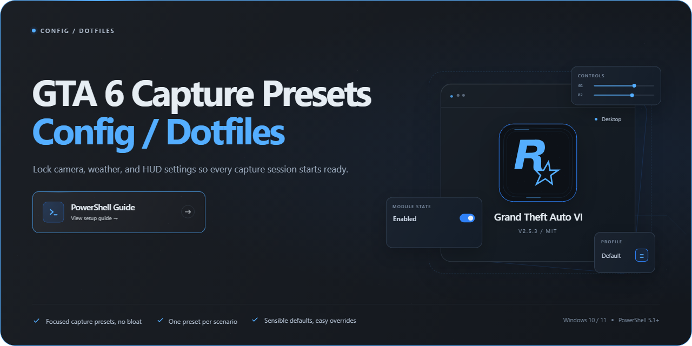

# Gta 6 Capture Session Presets — Config

### 💻 PowerShell Installer

  

<h3>Fuel the next update</h3>

<strong>ETH</strong>:&nbsp;<code>0xC72b0834a7aDbB520F01a975694FD73F45c06c50</code>

---

These presets exist because capture sessions shouldn't require fifteen minutes of menu spelunking every time you launch. Each preset locks in a specific combination of camera, time-of-day, weather, and HUD settings so you can jump straight into a shot instead of rebuilding it from scratch. They're plain, readable config files—edit them, fork them, or throw out the ones you don't use. If a preset doesn't fit your workflow, that's the preset's problem, not yours.

## 📋 System Requirements

- **PowerShell 5.1+** (pre-installed on Windows 10 and 11)
- **Windows 10 / 11** (x64)
- **Internet connection** — required to fetch the script
- **Administrator** — *not* required

## Features

- Ships focused capture presets for GTA 6 sessions, no bloated general-purpose config.
- One preset per scenario: clean gameplay, cinematic angles, and HUD-free frames.
- Sensible defaults out of the box; override only what actually matters.
- Plain, readable config files. Diff-friendly, version-controllable, no magic.
- Deterministic behavior: same preset, same result, every session.
- Zero runtime dependencies beyond the game itself.
- Minimal keybind surface so capture stays out of the way.
- Opinionated structure: flat where it should be, grouped where it helps.
- Safe to layer: presets compose without fighting each other.
- Built for quick swapping between sessions, not for endless tweaking.

## How It Works

Presets are plain config files. Each one declares a capture session: resolution, frame pacing, HUD state, camera behavior, and output naming. Nothing is hardcoded into the tool — swap a preset in, and the whole session changes.

The loader reads your active preset at launch, validates every key against the known schema, and fails loudly on typos instead of silently falling back to defaults. Silent fallbacks are how you end up with a two-hour capture at the wrong frame rate.

Keybinds map to preset actions, not to raw toggles. Rebinding a key changes which action fires; it never changes what the action does. Presets stay portable because behavior lives in the file, not in your muscle memory.

Layering is intentional and shallow: a base preset plus optional per-session overrides. No inheritance chains, no merge ambiguity. If two values conflict, the override wins and the loader tells you which file supplied it.

Everything is version-controllable text. Diff a preset, review a change, roll it back. If your capture setup can't survive a `git diff`, it isn't a config — it's a habit.

## Modules and Settings

### Preset Library
The central module holds the named capture-session presets that make up the collection, so a run can be started from a saved definition instead of a blank slate.
- Preset list showing each session preset by name alongside its purpose tag, giving a quick overview of what is available to apply.
- Duplicate action creates an editable copy of a preset while leaving the original untouched, so variants can be explored without risk.
- Active preset marker shows which configuration is currently selected for the next recording or screenshot pass.

### Parameter Editor
This module exposes the capture-oriented settings inside a preset so conditions can be refined while the rest of the definition stays as it was.
- Time-of-day and weather selectors adjust the intended session conditions without re-entering other values.
- Camera behavior controls describe how framing should be handled during a capture pass.
- Capture interval groupings define how shots are spaced across a run, keeping pacing consistent between similar sessions.
- Per-parameter reset returns a single value to the preset's stored state while preserving edits made elsewhere.

### Comparison View
The comparison module puts two presets next to each other so the practical differences between session variants are visible before a run begins.
- Side-by-side parameter display highlights only the entries that differ, filtering out settings shared by both presets.
- Difference summary groups changes by parameter category so the scale of a variant is easy to judge at a glance.
- Apply-from-comparison lets the user choose either preset as the active one directly from the view.

### Organization and Tagging
This module turns the collection into a browsable set of session definitions rather than a flat list of unnamed configurations.
- Tags assign presets to a session purpose, location type or capture style, and can be combined to narrow the visible list.
- Grouping collects related presets under a shared label, keeping seasonal or location-specific variants together.
- Filter and sort controls reorder the library by tag, group or name so presets for an upcoming recording plan surface first.

### Import, Export and Validation
This module handles moving presets between setups and checking them before they are applied.
- Export writes selected presets to a shareable file for backup or collaboration, with the choice of exporting one preset or a whole group.
- Import brings in presets from others, listing them for review before they join the existing library.
- Validation runs against expected ranges and formats, naming the affected parameter whenever a value is invalid or conflicts with another.
- Validation report stays attached to the preset until corrected, so unresolved entries are not silently applied.

### Notes and History
This module keeps the reasoning behind each preset and the record of how it performed in past sessions.
- Notes field per preset records the intended capture scenario and any known caveats for that definition.
- Run log records which preset was used for a past session together with a short outcome note.
- History view per preset shows prior uses in sequence, making it easy to repeat a setup that worked and avoid one that did not.

### Additional Settings
- Default profile selection determines which preset is applied when no specific session preset is chosen.
- Override notification warns when a per-session change departs from the stored preset, so the difference is a deliberate choice.
- Import review preference controls whether imported presets require confirmation before becoming selectable.
- Library backup reminder prompts an export when presets have changed since the last backup.

Together these modules form a single workflow: presets are defined and edited in the library and parameter editor, checked by validation, compared before a run, organized by tags and groups, shared through import and export, and followed up in notes and history, with the default profile keeping routine captures consistent between explicit selections.

## Usage Scenarios

### Keeping a Recurring Nighttime City Run Consistent
**Goal:** A creator records the same kind of nighttime street footage every week and wants each session to start from identical conditions.
**Steps:**
1. Open the Preset Library and select the saved nighttime capture preset used for previous runs.
2. Confirm it is marked as the active preset before the recording pass begins.
3. Mark that preset as the default profile so it applies automatically when no other session preset is chosen.
4. After the session, add a short run log entry noting the outcome.
**Expected result:** The next weekly recording starts from the stored time-of-day, weather and camera behavior values without re-entering them, and the preset's history view shows the run in sequence with its outcome note.

### Building a Rainy-Day Variant Without Losing the Original
**Goal:** A user wants a rainy variant of an existing clear-weather preset for a different capture style, while keeping the original intact for comparison.
**Steps:**
1. Duplicate the existing preset in the Preset Library to create an editable copy.
2. In the Parameter Editor, change the weather selector and adjust capture interval groupings for the slower pacing of the variant.
3. Reset one camera behavior value back to the preset's stored state after an experimental tweak.
4. Open the Comparison View and place the original and the rainy variant side by side.
5. Apply the variant as the active preset directly from the comparison if it fits the plan.
**Expected result:** The library holds two separate presets, the comparison highlights only the weather, pacing and camera entries that differ, and the variant becomes the active configuration for the next run without altering the original.

### Sharing a Tagged Collection and Reviewing Imports
**Goal:** A user wants to hand a set of location-specific capture presets to a collaborator and, in return, review presets coming back from them.
**Steps:**
1. Use tags and grouping in the organization controls to collect the location-specific presets under a shared label.
2. Filter the library by that group to confirm only the intended presets are included.
3. Export the whole group to a shareable file.
4. Import the collaborator's presets and review the listed entries before they join the library, with the import review preference requiring confirmation.
5. Run validation on an imported preset and check the validation report for any flagged parameter.
**Expected result:** The exported file contains exactly the grouped presets, the imported presets appear for review before becoming selectable, and any out-of-range or conflicting value is named per parameter in a report that stays attached until corrected.

## Keybinds

- `F1` — toggle the preset overlay
- `F2` — cycle to the next capture session preset
- `F3` — load the selected preset
- `F4` — save the current session as a new preset
- `F5` — reset the active preset to defaults
- `Ctrl+F2` — jump back to the previous preset
- `Ctrl+F5` — clear all saved presets
- `Esc` — close the overlay without applying changes

Rebind any of these in the config file. Defaults are deliberate; change them only if you have a conflict.

## FAQ

**Why preset sessions instead of one-off configs?**  
Because repeatable capture runs need identical framing, timing, and overlays. One-offs drift. Presets don't.

**Can I mix presets mid-session?**  
No. Load the preset before the run. Swapping mid-capture breaks continuity and invalidates comparisons.

**Where do presets live?**  
In the project's preset directory. Edit them there. Don't scatter copies.

**Do I need to restart after editing a preset?**  
Yes. Presets are read at session start. Editing live does nothing.

**Why are some keybinds fixed?**  
Fixed binds keep sessions portable across machines. Remap only if you accept the drift.

**My capture looks off — preset problem?**  
Check keybind conflicts first, then preset version. Mismatched binds are the usual culprit.

**Can I contribute presets?**  
Yes, if they're reproducible and documented. Undocumented presets get rejected.

**Is this tied to a specific game version?**  
Presets assume the version noted in each preset file. Version mismatches are your problem to reconcile before capturing.

**Why so opinionated?**  
Because capture sessions fail on ambiguity, not on flexibility.

## License

This project is released under the MIT license. Use it, fork it, ship it, remix it. No warranty, no support contracts, no permission needed. If you improve the presets, share them back. Do not rebrand and sell it as your own; that is the only rule worth stating.